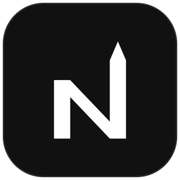
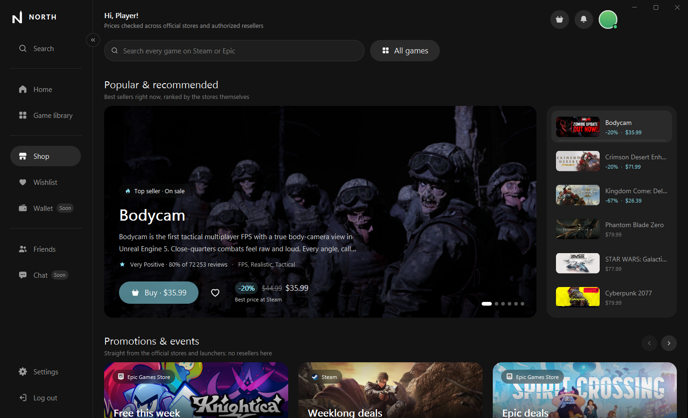
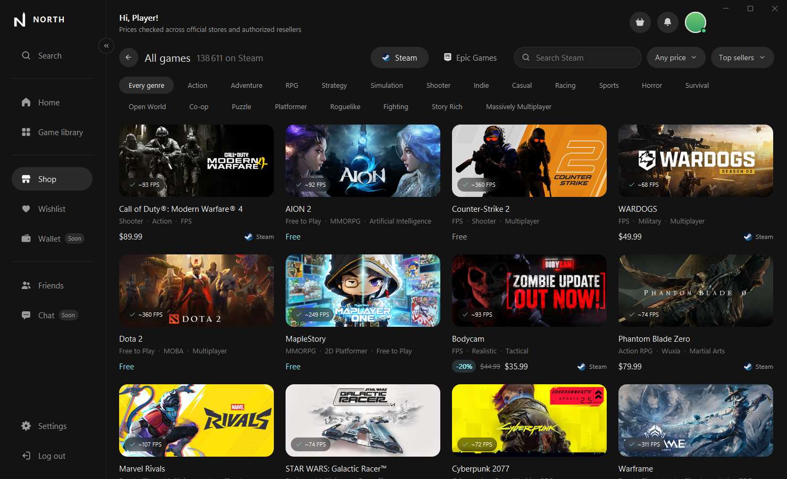
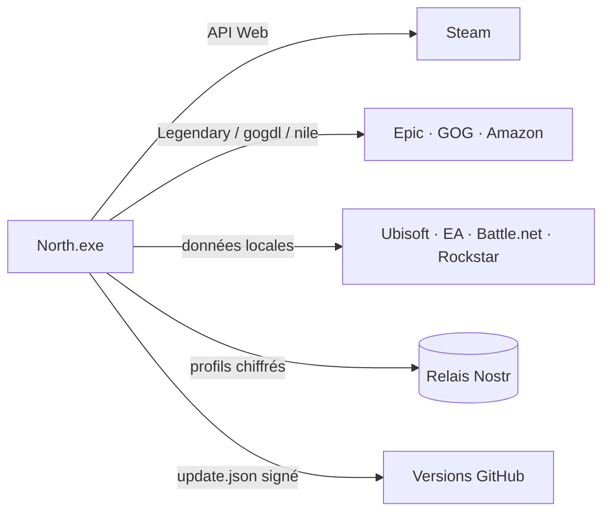

<p align="center">
  
</p>

<h1 align="center">North</h1>

<p align="center">
  <b>Tous vos jeux. Une seule maison.</b><br>
  Steam, Epic Games, GOG, Amazon Games, Ubisoft Connect, EA, Battle.net et Rockstar,<br>
  réunis dans un launcher qui s’ouvre avant que vous ayez lâché la souris.
</p>

<p align="center">
  <a href="https://github.com/JeremGamingYT/North-Launcher/releases/latest"><b>⬇ Télécharger pour Windows</b></a>
  &nbsp;·&nbsp; Windows 10 et 11, 64 bits &nbsp;·&nbsp; gratuit
  <br><br>
  <a href="README.md">English</a> &nbsp;·&nbsp; <b>Français</b>
</p>

<p align="center">
  
</p>

## Pourquoi North ?

Au fil des années, vous avez acheté des jeux sur cinq boutiques, et chacune veut maintenant son
launcher, ses mises à jour et son icône dans la zone de notification. Retrouver *ce* jeu, c’est
d’abord se souvenir d’où il vient.

North les remet tous sur la même étagère. Vos jeux, votre temps de jeu et vos succès, de tous vos
comptes, dans un launcher rapide, discret et agréable à retrouver. Il tourne uniquement sur votre
PC : aucun compte North à créer, aucun serveur à nous qui collecterait vos données.

## Ce que vous y trouvez

**🎮 Une seule bibliothèque**
- Tous les jeux de tous vos comptes, avec leur vrai temps de jeu et leurs succès.
- Installez, mettez à jour, lancez et désinstallez vos jeux Steam, Epic, GOG et Amazon depuis
  North. Les jeux Steam peuvent même s’installer sans ouvrir Steam, grâce à SteamCMD de Valve.
- Un jeu possédé sur deux boutiques ? North vous le dit, et vous laisse choisir quel exemplaire
  installer.
- **Lancement rapide** (optionnel) : <kbd>Win</kbd>+<kbd>Alt</kbd>+<kbd>N</kbd> n’importe où dans
  Windows, quelques lettres, Entrée. Vous jouez.

**🛒 Une boutique qui veille sur vous**
- Les prix comparés entre les boutiques officielles, le meilleur choisi pour vous.
- Chaque jeu indique si **votre PC peut le faire tourner**, directement sur sa carte, promos
  comprises.
- Vous l’avez déjà ailleurs ? North vous prévient **avant** que vous l’achetiez une deuxième fois.
- Jeux gratuits, promos, classements, calendrier des sorties et liste de souhaits avec alertes de
  prix.

**📅 Votre temps, à votre façon**
- **Téléchargements planifiés :** les mises à jour (et les nouvelles installations, si vous
  voulez) attendent la nuit, ou les heures où votre connexion est libre.
- Les téléchargements se mettent en pause pendant que vous jouez, puis reprennent où ils en étaient.

**✨ Votre année de jeu**
- Un bilan annuel sur votre profil : heures jouées, vos jeux phares, mois par mois, vos moments
  de jeu, vos genres et plateformes, votre plus longue session. Enregistrez-le en image pour le
  partager.

**👋 Amis North**
- Échangez vos codes North avec un ami et voyez le profil North l’un de l’autre : temps de jeu,
  vitrine, jeux récents. Chiffré de bout en bout, sans compte, sans aucun serveur à nous.

**⚡ Rapide, vraiment**
- Le premier écran s’affiche environ **50 ms** après le lancement. Pendant que vous jouez, North
  s’efface et ne dessine plus rien.

**🌍 Dans votre langue**
- English, Français, Español, Deutsch, Italiano et Português (Brasil) : l’interface, mais aussi
  les descriptions de la boutique, les dates et les succès.

<p align="center">
  
</p>

## Télécharger

Les fichiers sont dans la **[dernière version](https://github.com/JeremGamingYT/North-Launcher/releases/latest)**.

| Fichier | Pour |
|---|---|
| `North-Setup-<version>.exe` | **Recommandé.** Installe North pour vous seul, sans droits administrateur, et l’ajoute au menu Démarrer et aux *Applications*. Il vous demande quelques premiers choix (animation d’ouverture, lancement rapide) et peut préparer tout de suite les outils de comptes (Epic, GOG, Amazon, SteamCMD). |
| `North-<version>-win64.zip` | Si vous préférez ne pas lancer d’installateur. Décompressez où vous voulez et lancez `North.exe`. |
| `SHA256SUMS.txt` | Les empreintes des deux fichiers. |

Ensuite, North **se met à jour tout seul** : il vous le propose une fois par version, et chaque
mise à jour est vérifiée avec la signature de North avant de s’exécuter.

> **À propos de l’avertissement SmartScreen.** North n’est pas encore signé, Windows peut donc
> dire qu’il ne reconnaît pas l’éditeur. Choisissez *Informations complémentaires* → *Exécuter
> quand même*. Pour être sûr que le fichier est le bon, comparez d’abord son empreinte avec
> `SHA256SUMS.txt` :
> ```powershell
> Get-FileHash .\North-Setup-0.5.0.exe -Algorithm SHA256
> ```

## Vos comptes restent les vôtres

- **Vos mots de passe ne sont jamais gardés.** Ils vont directement à la connexion de chaque
  plateforme.
- **Vos connexions sont chiffrées sur votre PC** avec la protection de Windows (DPAPI). Copiées
  sur un autre PC, elles sont illisibles.
- **North n’a pas de serveur.** Votre bibliothèque, vos réglages et vos connexions restent sur
  votre PC.
- **Toutes les connexions sont chiffrées** (HTTPS, images comprises), et chaque outil que North
  télécharge est vérifié avant de s’exécuter.
- **Vos amis North ne voient que ce que vous choisissez.** Profil sur *Vous seul* : rien n’est
  publié du tout.

## Sous le capot

Pour les curieux. North est une application Windows native, pensée pour démarrer vite et rester
légère.

| | |
|---|---|
| **Interface** | C++17 et Qt 5.15 Quick. Le QML est compilé à l’avance ; aucune source d’interface n’est livrée dans l’exe. |
| **Rendu** | Direct3D 11 via ANGLE. Environ 120 ms plus tôt que l’OpenGL du pilote, au pixel près. |
| **Démarrage instantané** | Une fenêtre Win32 peint le dernier premier écran depuis son propre thread avant même que Qt soit chargé (≈ 50 ms). La vraie fenêtre prend ensuite sa place sur les mêmes pixels. |
| **Réseau** | WinHTTP (le TLS et les certificats du système) sur un pool dédié ; jaquettes et données des boutiques sont mises en cache sur disque et préchargées là où vous pointez. |
| **Boutiques** | L’API Web de Steam et SteamCMD ; Epic, GOG et Amazon via les outils open source éprouvés [Legendary](https://github.com/legendary-gl/legendary), [gogdl](https://github.com/Heroic-Games-Launcher/heroic-gogdl) et [nile](https://github.com/imLinguin/nile), figés et vérifiés par SHA-256. |
| **Amis North** | Une petite bibliothèque Rust dans North.exe qui parle [Nostr](https://nostr.com) : chaque profil est chiffré pour un seul ami (NIP-44 : ECDH secp256k1, ChaCha20, HMAC-SHA256), signé (Schnorr) et transmis par des relais publics en TLS. Les relais ne voient jamais que des données opaques. |
| **Mises à jour** | `update.json` signé en ECDSA P-256 ; la taille et le SHA-256 de l’installateur sont vérifiés après le téléchargement, puis juste avant l’exécution. Une version de sécurité peut obliger toutes les anciennes à se mettre à jour. |
| **Durcissement** | ASLR, DEP, Control Flow Guard (et CET shadow stacks dans le Setup) ; DLL chargées uniquement depuis le dossier de North et System32 ; ni symboles, ni chemins, ni clés dans les binaires. |
| **Empreinte** | Un exécutable d’environ 10 Mo, plus Qt. Aucun service en arrière-plan : North attend dans la zone de notification, ou pas du tout. |



## Questions

**North est-il gratuit ?** Oui, à télécharger comme à utiliser.

**Remplace-t-il Steam ou Epic ?** Non, il fonctionne avec eux. Certains jeux ont encore besoin du
launcher de leur boutique pour tourner, et North ne le ferme jamais dans votre dos.

**Faut-il un compte North ?** Non. Vous vous connectez à vos boutiques, c’est tout.

**Le code source est-il public ?** Pas pour l’instant. Ce dépôt contient les téléchargements et
cette page.

**Un problème ?** Ouvrez une [issue](https://github.com/JeremGamingYT/North-Launcher/issues).
Pour un problème de sécurité, écrivez plutôt en privé au propriétaire.

## Désinstaller

*Paramètres › Applications › North › Désinstaller.* Vos jeux restent où ils sont. Les données de
North (connexions, réglages) ne sont supprimées que si vous le demandez.

## Licences

North inclut ou télécharge des logiciels tiers, chacun sous sa propre licence :

- **Qt 5.15**, LGPL-3.0. Lié dynamiquement et non modifié ; sources sur
  [download.qt.io](https://download.qt.io/archive/qt/5.15/). **ANGLE**, BSD, livré avec Qt.
- **QR Code generator** de Project Nayuki, MIT.
- **Bibliothèques Rust** dans North.exe ([nostr](https://github.com/rust-nostr/nostr), rustls,
  ring, tungstenite, webpki-roots et leurs dépendances) : MIT, Apache-2.0, ISC, BSD-3-Clause,
  Unicode-3.0, CC0-1.0 et CDLA-Permissive-2.0.
- **Legendary, gogdl et nile**, GPL-3.0. Programmes séparés, téléchargés depuis leurs versions
  officielles.
- **SteamCMD,** l’outil de Valve, téléchargé chez Valve.

Steam, Epic Games, GOG, Amazon Games, Ubisoft Connect, EA, Battle.net et Rockstar sont des
marques de leurs propriétaires. North n’est affilié à aucun d’eux.
