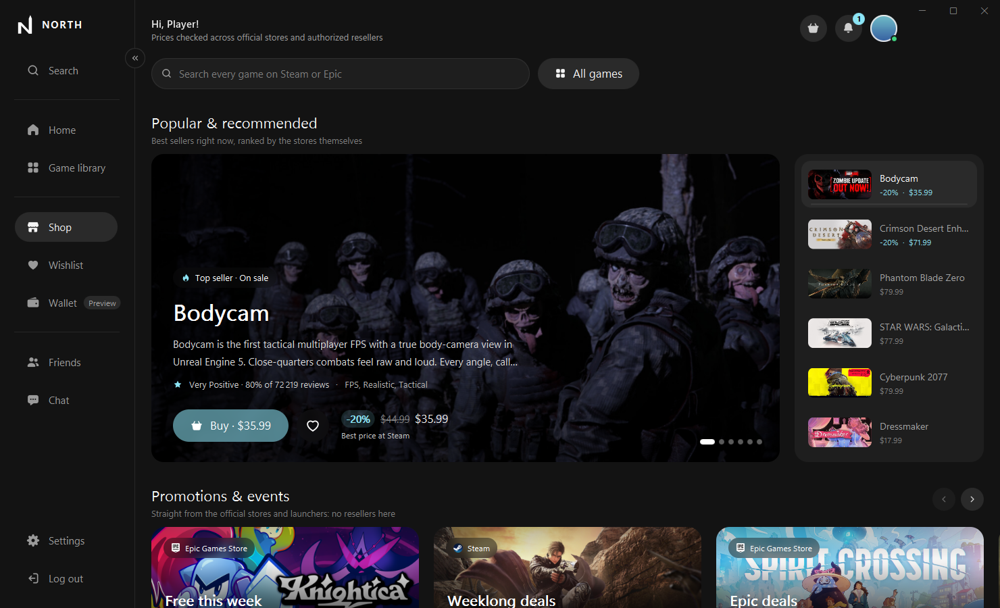
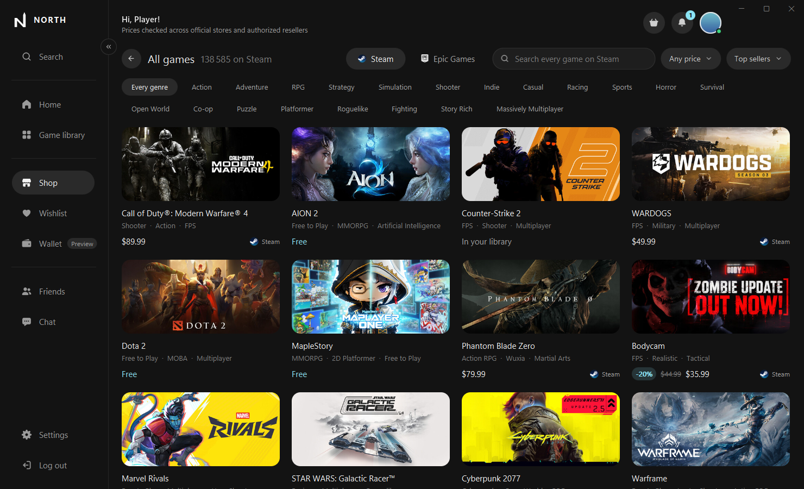

<p align="center">
  
</p>

<h1 align="center">North</h1>

<p align="center">
  <b>One library for every game you own.</b><br>
  Steam, Epic Games, GOG, Amazon Games, Ubisoft Connect, EA, Battle.net and Rockstar, in one fast launcher.
</p>

<p align="center">
  <a href="https://github.com/JeremGamingYT/North-Launcher/releases/latest"><b>Download for Windows</b></a>
  &nbsp;·&nbsp; Windows 10 and 11, 64-bit &nbsp;·&nbsp; free
</p>

<p align="center">
  
</p>

## What North does

- **Your whole library in one place.** Every game from every account, with its real play time,
  its achievements and the games installed on this PC.
- **Install, update, play and uninstall.** On Steam, Epic, GOG and Amazon, from North itself.
  Steam games can be installed without opening Steam, through Valve's own SteamCMD.
- **A shop that compares.** Prices are checked across the official stores, with the best one
  picked for you. It also has free games, deals, charts, a release calendar and a wishlist with
  price alerts.
- **It opens at once.** North shows its first screen about 50 ms after you start it.
- **Universal search.** Every game you own or could buy, by name, genre or tag.
- **Made for players.**
  - "Can this PC run it?" for any game;
  - controllers, the activity timeline and duplicates detection;
  - game shortcuts and Discord status.

<p align="center">
  
</p>

## Download

Take the files from the **[latest release](https://github.com/JeremGamingYT/North-Launcher/releases/latest)**.

| File | For |
|---|---|
| `North-Setup-<version>.exe` | **Recommended.** Installs North for you alone, with no administrator rights, and adds it to the Start menu and *Apps*. It can also get the account tools right away (Epic, GOG, Amazon, SteamCMD), so signing in never waits. |
| `North-<version>-win64.zip` | If you'd rather not run an installer. Unzip anywhere and start `North.exe`. The account tools download the first time they're needed. |
| `SHA256SUMS.txt` | The fingerprints of both files. |

To check a download, run this in PowerShell and compare with `SHA256SUMS.txt`:

```powershell
Get-FileHash .\North-Setup-0.4.0.exe -Algorithm SHA256
```

> **About the SmartScreen warning.** North isn't code-signed yet, so Windows may say it doesn't
> recognise the publisher. Choose *More info* → *Run anyway*. You can also check the file's
> fingerprint first, as above.

## Your accounts stay yours

- **Your passwords are never kept.** They go straight to each platform's own sign-in.
- **Sign-ins are encrypted on your PC** with Windows' own protection (DPAPI). Copied to another
  PC, they can't be read.
- **North has no server.** Your library, settings and sign-ins live only on your PC. Your IP
  address is seen only by the platforms North talks to, as with their own launchers.
- **Every connection is HTTPS,** pictures included.
- **Each tool North downloads is verified before it runs:** pinned fingerprints, or Valve's
  signature for SteamCMD.

## Uninstall

Go to *Settings › Apps › North › Uninstall*. Your games stay where they are. North's data
(sign-ins, settings) is deleted only if you ask.

## Licences

North is free to download and use; its source code isn't public. North includes or downloads
third-party software, each under its own licence:

- **Qt 5.15**, LGPL-3.0. Dynamically linked and unmodified; source at
  [download.qt.io](https://download.qt.io/archive/qt/5.15/).
- **ANGLE**, BSD, shipped with Qt.
- **QR Code generator** by Project Nayuki, MIT.
- **Legendary, gogdl and nile**, GPL-3.0. They run as separate programs and are downloaded from
  their official releases: [legendary](https://github.com/legendary-gl/legendary),
  [heroic-gogdl](https://github.com/Heroic-Games-Launcher/heroic-gogdl),
  [nile](https://github.com/imLinguin/nile).
- **SteamCMD,** Valve's own tool, downloaded from Valve.

Steam, Epic Games, GOG, Amazon Games, Ubisoft Connect, EA, Battle.net and Rockstar are
trademarks of their owners. North isn't affiliated with them.
