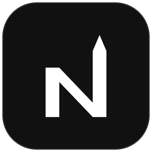

<p align="center">
  
</p>

<h1 align="center">North</h1>

<p align="center">
  <b>All your games. One home.</b><br>
  Steam, Epic Games, GOG, Amazon Games, Ubisoft Connect, EA, Battle.net and Rockstar,<br>
  together in one launcher that opens before you've let go of the mouse.
</p>

<p align="center">
  <a href="https://github.com/JeremGamingYT/North-Launcher/releases/latest"><b>⬇ Download for Windows</b></a>
  &nbsp;·&nbsp; Windows 10 and 11, 64-bit &nbsp;·&nbsp; free
  <br><br>
  <b>English</b> &nbsp;·&nbsp; <a href="README.fr.md">Français</a>
</p>

<p align="center">
  
</p>

## Why North?

You bought games on five stores over the years, and now each one wants its own launcher, its own
updates and its own window in the notification area. Finding *that* game means remembering where
you bought it.

North puts them all back on one shelf. Your games, your play time and your achievements, from
every account, in a launcher that's quick, quiet and pleasant to come back to. It runs on your PC
only: no North account to create, no server of ours collecting your data.

## What you get

**🎮 One library**
- Every game from every account, with its real play time and achievements.
- Install, update, play and uninstall Steam, Epic, GOG and Amazon games from North itself.
  Steam games can even be installed without opening Steam, through Valve's own SteamCMD.
- Own a game on two stores? North tells you, and lets you pick which copy to install.
- **Quick launch** (optional): press <kbd>Win</kbd>+<kbd>Alt</kbd>+<kbd>N</kbd> anywhere in
  Windows, type a few letters, press Enter. You're playing.

**🛒 A shop that looks out for you**
- Prices compared across the official stores, with the best one picked for you.
- Each game says whether **your PC can run it**, right on its card, deals included.
- Already own it elsewhere? North warns you **before** you buy it a second time.
- Free games, deals, charts, a release calendar, and a wishlist with price alerts.

**📅 Your time, your way**
- **Scheduled downloads:** updates (and new installs, if you like) wait for the night, or
  whenever your connection is free.
- Downloads pause while you play, then pick up where they left off.

**✨ Your year in games**
- A yearly review on your profile: hours played, your top games, month by month, when you play,
  your genres and platforms, your longest session. Save it as a picture to share.

**👋 North friends**
- Swap North codes with a friend and see each other's North profile: play time, showcase, recent
  games. Encrypted end to end, no account needed, no server of ours involved.

**⚡ Fast, really**
- The first screen shows about **50 ms** after you start North. While a game runs, North steps
  aside and uses almost nothing.

**🌍 In your language**
- English, Français, Español, Deutsch, Italiano and Português (Brasil): the interface, but also
  the shop's descriptions, the dates and the achievements.

<p align="center">
  
</p>

## Download

Take the files from the **[latest release](https://github.com/JeremGamingYT/North-Launcher/releases/latest)**.

| File | For |
|---|---|
| `North-Setup-<version>.exe` | **Recommended.** Installs North for you alone, with no administrator rights, and adds it to the Start menu and *Apps*. It asks a few first choices (opening animation, quick launch) and can get the account tools ready right away (Epic, GOG, Amazon, SteamCMD). |
| `North-<version>-win64.zip` | If you'd rather not run an installer. Unzip anywhere and start `North.exe`. |
| `SHA256SUMS.txt` | The fingerprints of both files. |

North then **updates itself**: it asks once per version, and every update is checked against
North's signature before it runs.

> **About the SmartScreen warning.** North isn't code-signed yet, so Windows may say it doesn't
> recognise the publisher. Choose *More info* → *Run anyway*. To be sure the file is the real one,
> compare its fingerprint with `SHA256SUMS.txt` first:
> ```powershell
> Get-FileHash .\North-Setup-0.5.0.exe -Algorithm SHA256
> ```

## Your accounts stay yours

- **Your passwords are never kept.** They go straight to each platform's own sign-in.
- **Sign-ins are encrypted on your PC** with Windows' own protection (DPAPI). Copied to another
  PC, they can't be read.
- **North has no server.** Your library, settings and sign-ins live only on your PC.
- **Every connection is encrypted** (HTTPS, pictures included), and each tool North downloads is
  verified before it runs.
- **North friends see only what you choose.** Set your profile to *Only you* and nothing is
  published at all.

## Under the hood

For the curious. North is a native Windows application, built to start fast and stay light.

| | |
|---|---|
| **Interface** | C++17 and Qt 5.15 Quick. The QML is compiled ahead of time; no interface source ships in the exe. |
| **Rendering** | Direct3D 11 through ANGLE. About 120 ms sooner than the driver's OpenGL, same pixels. |
| **Instant start** | A Win32 window paints the last first screen from its own thread before Qt is loaded (≈ 50 ms). The real window then takes its place on the same pixels. |
| **Network** | WinHTTP (the system's TLS and certificates) on a dedicated pool; covers and store data are cached on disk and fetched ahead of where you point. |
| **Stores** | Steam's Web API and SteamCMD; Epic, GOG and Amazon through the proven open-source tools [Legendary](https://github.com/legendary-gl/legendary), [gogdl](https://github.com/Heroic-Games-Launcher/heroic-gogdl) and [nile](https://github.com/imLinguin/nile), pinned and checked by SHA-256. |
| **North friends** | A small Rust library inside North.exe speaking [Nostr](https://nostr.com): each profile is encrypted for one friend (NIP-44: secp256k1 ECDH, ChaCha20, HMAC-SHA256), signed (Schnorr) and passed through public relays over TLS. Relays only ever see opaque blobs. |
| **Updates** | `update.json` signed with ECDSA P-256; the setup's size and SHA-256 are checked after download and again right before it runs. A security release can require every older version to update. |
| **Hardening** | ASLR, DEP, Control Flow Guard (and CET shadow stacks in Setup); DLLs load only from North's folder and System32; no debug symbols, paths or keys in the binaries. |
| **Footprint** | One ~10 MB executable plus Qt. No background service: North sleeps in the notification area, or not at all. |

```mermaid
flowchart LR
  N[North.exe] -- Web API --> S[Steam]
  N -- Legendary / gogdl / nile --> E[Epic · GOG · Amazon]
  N -- reads local data --> L[Ubisoft · EA · Battle.net · Rockstar]
  N -- encrypted profiles --> R[(Nostr relays)]
  N -- signed update.json --> G[GitHub releases]
```



## Questions

**Is North free?** Yes, to download and to use.

**Does it replace Steam or Epic?** No, it works alongside them. Some games still need their
store's launcher to run, and North never closes it behind your back.

**Do I need a North account?** No. You sign in to your stores, and that's all.

**Is the source code public?** Not for now. This repository holds the downloads and this page.

**Something's wrong?** Open an [issue](https://github.com/JeremGamingYT/North-Launcher/issues).
For a security problem, please write privately to the owner instead.

## Uninstall

*Settings › Apps › North › Uninstall.* Your games stay where they are. North's data (sign-ins,
settings) is deleted only if you ask.

## Licences

North includes or downloads third-party software, each under its own licence:

- **Qt 5.15**, LGPL-3.0. Dynamically linked and unmodified; source at
  [download.qt.io](https://download.qt.io/archive/qt/5.15/). **ANGLE**, BSD, ships with Qt.
- **QR Code generator** by Project Nayuki, MIT.
- **Rust libraries** inside North.exe ([nostr](https://github.com/rust-nostr/nostr), rustls, ring,
  tungstenite, webpki-roots and their dependencies): MIT, Apache-2.0, ISC, BSD-3-Clause,
  Unicode-3.0, CC0-1.0 and CDLA-Permissive-2.0.
- **Legendary, gogdl and nile**, GPL-3.0. They run as separate programs, downloaded from their
  official releases.
- **SteamCMD,** Valve's own tool, downloaded from Valve.

Steam, Epic Games, GOG, Amazon Games, Ubisoft Connect, EA, Battle.net and Rockstar are
trademarks of their owners. North isn't affiliated with them.
